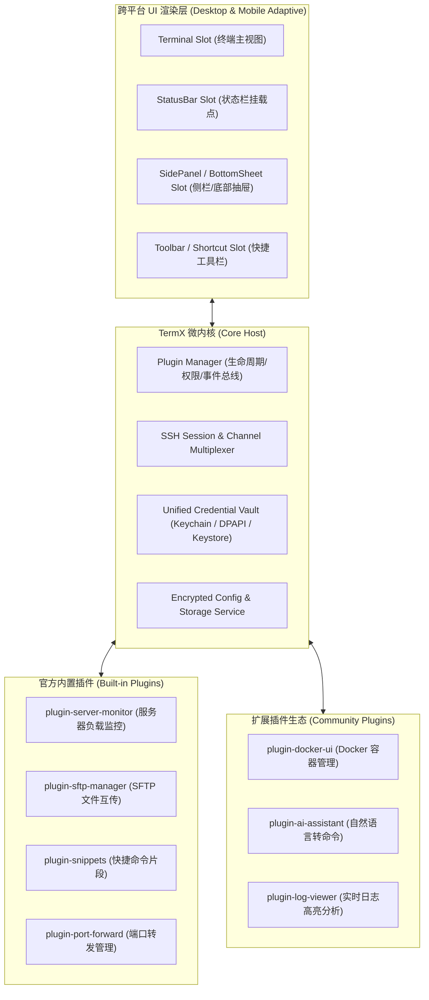

# TermX — 跨平台插件化 SSH 终端产品需求文档 (PRD) 与技术选型

## 1. 产品概述 (Product Overview)

### 1.1 产品定位
**TermX** 是一款面向开发者、运维工程师与极客用户的**全平台（Windows / macOS / iOS / Android）现代化 SSH 终端与服务器管理工具**。它兼顾桌面端的高效多任务体验与移动端极致的触控交互体验，采用**微内核 + 插件化（Microkernel + Plugin Architecture）**设计理念，将核心连接能力与扩展功能（SFTP 文件互传、服务器负载监控、代码片段、端口转发等）解耦，支持按需扩展。

### 1.2 核心目标
1. **一套代码，全形态原生级体验**：全面覆盖 Windows、macOS、iOS、iPadOS、Android，采用**三态自适应架构（Phone 手机端 / Tablet & iPadOS 平板端 / Desktop 桌面端）**，针对键鼠、触控板与纯触屏提供差异化 UI。
2. **苹果生态无缝安全凭据**：在 macOS、iOS 与 iPadOS 上深度集成 Apple Keychain（钥匙串），支持 Face ID / Touch ID 解锁及 iCloud Keychain 跨设备凭据同步；Windows 与 Android 分别集成 Windows Credential Locker 与 Android Keystore。
3. **极致的手机与 iPad 端交互**：解决移动设备敲命令痛点，针对手机提供单手扩展键盘栏，针对 iPad 深度适配**妙控键盘（Magic Keyboard）、台前调度（Stage Manager）、分屏多任务（Split View / Slide Over）、系统级跨应用拖拽与悬浮快捷键面板**。
4. **可视化运维与文件互传**：内置实时服务器负载仪表盘（CPU、内存、磁盘、网络、进程）与双栏/抽屉式 SFTP 文件管理器。
5. **高扩展插件体系**：定义标准化的插件生命周期与宿主 API（Host API），任何功能模块均可通过插件机制挂载到终端会话、侧边栏、状态栏或底部面板。

---

## 2. 功能需求说明 (PRD)

### 2.1 主机与连接管理 (Core)
| 功能模块 | 优先级 | 详细需求描述 |
| :--- | :---: | :--- |
| **主机配置管理** | P0 | 支持主机分组、标签（Tags）、搜索过滤、快速连接（Quick Connect）。配置项包含 Host、Port、Username、认证方式、跳板机（ProxyJump / Bastion）、启动初始化命令、环境变量与终端编码。 |
| **多认证方式支持** | P0 | 支持密码认证、SSH 私钥认证（RSA / Ed25519 / ECDSA，支持带 Passphrase 私钥）、Keyboard-Interactive（含 2FA/OTP 动态验证码弹窗）、SSH Agent 转发。 |
| **系统安全钥匙串集成** | P0 | - **iOS / macOS**：直接写入系统 Keychain，支持配置 `kSecAttrSynchronizable` 开启 iCloud 钥匙串同步，支持生物识别（Touch ID / Face ID）二次验证读取。<br>- **Windows**：集成 Windows Credential Manager (`CredWrite` / DPAPI)。<br>- **Android**：集成 Android Keystore + EncryptedSharedPreferences。 |
| **私钥生成器与导入** | P1 | 内置 Ed25519 / RSA 密钥对生成工具，支持一键复制公钥或通过 `ssh-copy-id` 自动部署公钥到目标服务器。 |
| **多标签与分屏会话** | P0 | 桌面端支持多 Tab 标签页与水平/垂直分屏（Split Pane）；移动端支持顶部胶囊标签快速切换活跃会话与断线自动重连。 |

---

### 2.2 极致移动端体验专项设计 (Mobile UX)
针对 iOS 与 Android 手机屏幕小、无物理功能键、网络易切换的特点专门设计：

1. **增强型专业虚拟键盘栏 (Accessory Keyboard Bar)**
   - **双层可滑动快捷栏**：固定在系统软键盘上方，包含 `ESC`、`TAB`、`CTRL`、`ALT`、`↑`、`↓`、`←`、`→`、`HOME`、`END`、`PGUP`、`PGDN`、`|`、`/`、`-`、`~`、`:` 等高频键。
   - **组合键状态锁定**：单击 `CTRL` 或 `ALT` 进入单次组合激活态（如紧接着按 `C` 发送 `Ctrl+C`），双击锁定长按态，并提供触觉反馈（Haptic Feedback）。
   - **虚拟触控板模式 (Trackpad Gesture)**：在终端区域支持双指滑动滚屏、单指长按呼出放大镜与光标精确定位，或开启“全屏虚拟触控摇杆”快速移动 Vim/Nano 光标。
2. **命令防抖与草稿箱 (Command Composer)**
   - 在弱网/高延迟 SSH 下，提供可选的“本地输入框（Local Input Overlay）”模式，在本地编辑长命令、支持语法高亮与历史自动补全，确认无误后一键发送到远端终端。
3. **快速命令片段 (Snippets One-Tap)**
   - 移动端底部抽屉一键呼出常用脚本片段（支持变量占位符如 `${container_id}`），免去手机端繁琐输入。
4. **移动网络优化与后台保活**
   - 自动发送 SSH KeepAlive 心跳包；切换 Wi-Fi / 蜂窝网络后自动静默重连并恢复会话上下文。
   - iOS 支持后台音频/Background Task 短时保活提醒；Android 支持前台服务（Foreground Service）持久保活通知栏。

---

### 2.3 iPadOS 与大屏平板专属 UI 及交互优化 (iPadOS Adaptive UX)
iPad 兼具“移动触屏”与“准桌面生产力（外接妙控键盘 + 触控板）”双重属性，不能简单照搬手机 UI 放大或直接塞入桌面 UI。TermX 针对 iPadOS 进行专门定制：

1. **多任务窗口动态响应式布局 (Split View / Slide Over / Stage Manager 台前调度)**
   - **三阶断点实时变换**：基于当前窗口实时宽度（而非固定设备类型）动态切换布局：
     - **Expanded（横屏全屏 / 台前调度大窗口 ≥ 900pt）**：采用类桌面端的**三栏工作区**（左侧可折叠主机/插件导航栏 + 中间多标签与水平/垂直分屏终端 + 右侧并排开启 SFTP 文件树或服务器负载监控面板）。
     - **Medium（竖屏全屏 / Split View 1/2 分屏 600~899pt）**：自动收起左侧常驻栏为浮动图标轨（Navigation Rail），右侧插件面板改为半屏滑出抽屉（Sheet）。
     - **Compact（Slide Over 侧拉浮窗 / Split View 1/3 窄窗 < 600pt）**：无感切换为手机端紧凑单栏布局，确保终端可显示的 `cols × rows` 字符区域最大化。
   - **PTY 尺寸无闪烁自适应**：在拖拽调整分屏比例或 Stage Manager 窗口大小时，添加防抖（Debounce 80ms）平滑重算终端行列数并发送 `SIGWINCH`，杜绝 `vim` / `htop` 界面错乱。

2. **妙控键盘 (Magic Keyboard) 与纯触屏双模智能切换**
   - **外接硬件键盘模式（Pro Keyboard Mode）**：
     - 自动检测硬件键盘连接状态，连接后隐藏大面积软键盘扩展栏，仅在底部保留极窄的**可隐藏胶囊快捷条**（或完全隐藏）。
     - **长按 `Command ⌘` 键呼出 iPadOS 原生风格快捷键菜单 (Shortcut Cheat Sheet)**，完整支持：
       - `⌘ + T` 新建会话、`⌘ + W` 关闭当前分屏/标签、`⌘ + 1~9` 切换标签
       - `⌘ + D` 左右垂直分屏、`⌘ + ⇧ + D` 上下水平分屏、`⌘ + [` / `⌘ + ]` 焦点在分屏间切换
       - `⌘ + K` 呼出全局命令/主机快速跳转面板（类似 Spotlight / VS Code Command Palette）
       - `⌘ + Shift + F` 一键展开/收起右侧 SFTP 面板、`⌘ + Shift + M` 展开/收起服务器负载面板
     - **硬核键位重映射**：针对 iPad 妙控键盘无物理 `ESC` 键（旧款）或键程不便痛点，支持在应用内将 **`CapsLock` 或 `⌘` / `Option` 映射为 `ESC` 或 `Ctrl`**（Vim / Tmux 重度用户刚需）。
   - **手持纯触屏模式（Touch & Thumb Mode）**：
     - **悬浮分体式快捷键盘球/面板 (Floating Ergonomic Pad)**：iPad 屏幕较宽，传统通栏键盘条导致双手握持时拇指够不到中间按键。支持开启**左右拇指扇区悬浮快捷键面板**（左侧悬浮 `ESC`、`CTRL`、`TAB`、`|`；右侧悬浮方向键摇杆与常用符号），可任意拖拽吸附在屏幕边缘并调节透明度。

3. **iPadOS 指针吸附与触控板深度适配 (Pointer & Trackpad)**
   - 适配 iPadOS 原生圆点指针磁性吸附效果（Pointer Hover & Lift Effect）：指针移至标签页、分屏分割线、SFTP 文件行、快捷按钮时呈现平滑高亮。
   - 触控板双指滑动在普通 Shell 下丝滑滚动历史缓冲区（Scrollback），进入 `tmux` / `vim` / `htop` / `mc` 等开启 Mouse Reporting 的程序时，自动将触控板手势与双指右键映射为标准 Xterm 鼠标序列。

4. **系统级跨应用拖拽互传 (iPadOS Drag & Drop)**
   - 当 TermX 与 iPad 系统“文件 (Files)” App、Safari 或“照片”分屏并排时：
     - **拖入上传**：直接用手指或触控板将外部 App 的文件拖拽到 TermX 的 SFTP 面板（甚至直接拖到终端对应目录下），自动触发 SFTP 上传队列。
     - **拖出下载**：长按 SFTP 列表中的远程文件并拖拽到分屏另一侧的本地“文件” App 或邮件中，自动流式下载并完成投递。

---

### 2.4 服务器负载监控插件 (`plugin-server-monitor`)
无需在服务器端预装任何 Agent，完全复用当前 SSH 连接（独立 Exec Channel 轮询或流式采集 `/proc` 与系统命令）：

- **顶部迷你状态栏 (Mini Status Pill)**：在终端顶部或底部状态栏常驻显示紧凑指标：`CPU 24% | RAM 3.2/8G | ↑1.2MB/s ↓450KB/s | Load 0.45`。
- **展开式监控抽屉/面板 (Monitor Dashboard)**：
  - **CPU**：总体使用率、每核心负载柱状图、1/5/15 分钟 Load Average 趋势折线图。
  - **内存与 Swap**：Used / Cached / Buffers / Available 可视化环形图与进度条。
  - **磁盘 I/O 与挂载点**：各分区容量使用率（`df -h`）告警高亮（>85% 橙色，>95% 红色）及实时读写速率。
  - **网络流量**：指定网卡（如 `eth0`）实时吞吐量折线图与 TCP 连接状态统计（ESTABLISHED / TIME_WAIT）。
  - **Top 进程列表**：展示 CPU/内存占用前 10 的进程，支持移动端一键发送 `SIGTERM` / `SIGKILL` 结束异常进程。
- **跨发行版兼容**：自动识别 Linux (`/proc/stat`, `/proc/meminfo`, `/proc/net/dev`)、macOS (`top`/`vm_stat`) 与 FreeBSD。

---

### 2.5 SFTP 可视化文件互传插件 (`plugin-sftp-manager`)
复用当前 SSH 会话或建立关联 SFTP 通道，实现高效文件管理：

- **交互形态自适应**：
  - **桌面端 (Windows/macOS) & iPad 横屏分屏**：支持经典“本地-远端双栏对比视图”或终端右侧常驻文件树，支持直接从系统资源管理器 / Finder / **iPadOS 文件 App 跨应用拖拽文件（System Drag & Drop）**上传下载。
  - **手机端 (iOS/Android) & iPad 紧凑浮窗**：采用底部上滑抽屉或独立 Tab 视图，完美对接 **iOS/iPadOS “文件 (Files)” App** 与 **Android SAF (Storage Access Framework)**，以及系统相册。
- **核心文件操作**：
  - 目录树浏览、面包屑导航、隐藏文件开关、按名称/大小/修改时间排序与模糊搜索。
  - 新建文件/文件夹、重命名、递归删除、修改权限（`chmod` 可视化九宫格勾选与 755 数值联动）。
  - **内置轻量级文本编辑器**：支持远程直接打开配置文件（如 `.env`, `nginx.conf`, `.bashrc`），语法高亮编辑并保存自动回传。
- **传输队列管理**：
  - 支持多文件并发传输、大文件分块进度条、实时速度显示、暂停/取消、断点续传（Resume）及同名文件冲突策略（覆盖/跳过/重命名）。

---

### 2.6 插件化架构设计 (Plugin System)

TermX 采用**宿主内核（Core Host）+ 插件（Plugin）**架构，保证核心轻量且功能无限扩展。



#### 插件标准接口规范 (`TermXPlugin`)
每个插件通过统一的 Manifest 与生命周期接口注册：
1. **元数据 (`PluginManifest`)**：包含 `id`, `name`, `version`, `permissions`（如 `ssh:exec`, `ssh:sftp`, `storage:local`, `ui:statusbar`, `ui:panel`）。
2. **宿主上下文 (`PluginContext`)**：向插件暴露受控能力：
   - `session.exec(command)`: 在当前活跃 SSH 连接上开启后台无感 Exec Channel 执行命令并获取 stdout/stderr（例如负载监控插件、Docker 管理插件使用）。
   - `session.openSftp()`: 获取当前会话的 SFTP 客户端句柄。
   - `terminal.write(data)` / `terminal.onData(callback)`: 向当前终端注入文本或监听终端输出流。
   - `ui.registerStatusBarWidget(...)`: 在状态栏注册实时组件。
   - `ui.registerPanel(...)`: 注册侧边栏（桌面端）或底部抽屉（移动端）面板。
   - `storage.get/set(...)`: 插件独立的持久化键值存储。

---

## 3. 技术选型对比与推荐方案 (Tech Selection)

针对**“同时支持 Android、iOS、macOS、Windows 四端 + 手机端体验极佳 + 原生级钥匙串支持 + SSH/SFTP 高性能 + 插件化架构”**的核心诉求，我们对主流跨平台方案进行了深度对比：

### 3.1 跨平台框架选型对比

| 评估维度 | 方案 A：**Flutter 3.x (Dart + Rust FFI 可选)** (⭐ 强烈推荐) | 方案 B：Tauri 2.0 (Rust + React/Vue) | 方案 C：React Native / Lynx |
| :--- | :--- | :--- | :--- |
| **四端覆盖度** | **极佳**。一套代码原生编译为 iOS、Android、macOS、Windows 高性能机器码。 | 桌面端极佳，移动端（iOS/Android）依赖系统 WebView，移动端手势与软键盘控制较弱。 | iOS/Android 强，但 Windows/macOS 官方社区支持度与成熟度远不如 Flutter。 |
| **移动端触控与键盘体验** | **极佳**。自绘引擎 (Impeller) 120Hz 丝滑帧率，精准控制软键盘高度、自定义键盘扩展栏与震动反馈。 | 一般。移动端 WebView 处理软键盘弹起、虚拟按键焦点截获容易出现闪烁或失焦。 | 较好，但终端 Canvas 高频字符重绘需要桥接优化。 |
| **终端渲染性能** | **成熟**。基于 `xterm.dart` 硬件加速 Canvas 渲染，支持海量日志滚动、256 色/真彩色与 CJK 中文字符对齐。 | 成熟（基于 `xterm.js` WebGL），但在移动端低功耗模式下帧率受 WebView 限制。 | 需内嵌 WebView 跑 `xterm.js`，存在 Bridge 通信延迟。 |
| **Keychain 钥匙串集成** | **原生级完备**。通过 `flutter_secure_storage` + 原生 Swift Keychain Services 定制，完美支持 iCloud Keychain 与 FaceID。 | 需自行编写大量 Rust Swift/Kotlin 插件桥接移动端生物识别与钥匙串。 | 移动端成熟，桌面端需额外封装。 |
| **SSH / SFTP 核心库** | 纯 Dart 方案 (`dartssh2`) 开箱即用；或通过 `flutter_rust_bridge` 接入 Rust `russh`，兼顾开发效率与极致性能。 | Rust `russh` + `russh-sftp` 性能极强，但前端与 Rust 间大文件流式传输需额外封装。 | 缺乏成熟的纯 JS 高性能 SSH2/SFTP 实现，必须写四端 C++/Rust JSI 原生模块。 |

> [!IMPORTANT]
> **最终推荐技术栈：Flutter 3.x 全平台架构**（核心业务与插件体系使用 Dart 实现，后续对极限吞吐量场景可无缝挂载 Rust FFI 模块）。这不仅是目前开源界最成功的跨平台 SSH 客户端（如 *ServerBox* 等标杆项目）验证过的黄金路线，而且能以最高效率交付极致的 iOS/Android 手感与桌面端生产力。

---

### 3.2 详细技术栈清单 (Recommended Stack)

| 层级 | 选用技术 / 库 | 选型理由 |
| :--- | :--- | :--- |
| **应用框架** | **Flutter 3.x (Dart 3)** | 统一渲染管线（Impeller），支持桌面多窗口/分屏布局与移动端流畅手势动画。 |
| **状态管理与依赖注入** | **Riverpod 2.x** | 响应式状态管理，天然适合管理多 SSH 会话实例、实时负载数据流与插件动态挂载。 |
| **终端模拟器引擎** | **`xterm` (xterm.dart)** | 高性能纯 Dart 终端模拟器核心，支持 VT100/VT220/xterm 控制序列、鼠标模式、多国语言与自定义主题字体（JetBrains Mono / Nerd Fonts）。 |
| **SSH2 & SFTP 协议栈** | **`dartssh2`** | 纯 Dart 实现的 SSH2 与 SFTP 协议栈，零 C 编译依赖，完美跨 4 端运行，支持 Shell、Exec、SFTP、端口转发与 ProxyJump 跳板机。 |
| **安全凭据与钥匙串** | **`flutter_secure_storage` + `local_auth` + 原生 Keychain Channel** | - **macOS / iOS**：底层直接调用 Apple `Security.framework` (Keychain Services)，配置 `kSecAttrAccessibleWhenUnlocked` 与 `kSecAttrSynchronizable`（支持 iCloud Keychain 同步），配合 `local_auth` 调用 Touch ID / Face ID。<br>- **Windows**：调用 Windows DPAPI / Credential Locker。<br>- **Android**：调用 Android Keystore + BiometricPrompt。 |
| **本地配置与插件存储** | **Drift (SQLite) / Hive** | 存储主机非敏感元数据、命令历史、代码片段、SFTP 传输记录及各插件独立沙盒配置。 |
| **图表可视化** | **`fl_chart`** | 轻量级高帧率图表库，用于绘制服务器 CPU 历史曲线、网络吞吐波形图及磁盘圆环图。 |
| **跨应用拖拽与桌面/iPad 交互** | **`super_drag_and_drop` + Flutter `Shortcuts` / `Actions` / `MouseRegion`** | 原生支持 **iPadOS Split View 跨应用拖拽**、macOS Finder 与 Windows Explorer 文件拖入拖出；原生支持 iPad 妙控板指针吸附与 `⌘` 快捷键矩阵。 |
| **插件化机制** | **基于强类型接口的微内核插件引擎 + (可选) `hetu_script` / Lua / JS 沙盒** | 第一阶段采用编译期模块化插件注册（Built-in & Modular Package Plugins，零性能损耗、类型安全）；第二阶段支持动态脚本插件加载。 |

---

## 4. 系统架构与核心模块设计

### 4.1 目录结构规划 (`TermX`)
```text
d:\github\TermX\
├── lib/
│   ├── main.dart                      # 应用入口与全局初始化
│   ├── core/                          # 微内核核心层 (Microkernel Core)
│   │   ├── ssh/                       # SSH 会话池、重连状态机、Channel 复用器
│   │   ├── vault/                     # 跨平台钥匙串凭据中心 (Keychain / Keystore / DPAPI)
│   │   ├── plugin_system/             # 插件管理器、PluginContext API、Slot 插槽总线
│   │   ├── storage/                   # 主机配置与本地持久化服务
│   │   └── theme/                     # 三态响应式断点 (Phone / iPad & Tablet / Desktop) 与终端主题
│   ├── ui/                            # 宿主壳层 UI (三态自适应)
│   │   ├── desktop/                   # Windows / macOS 侧边栏、多标签与分屏工作区
│   │   ├── tablet/                    # iPadOS / Android 平板：Stage Manager 适配、悬浮分体键盘、妙控键盘快捷键面板与并排抽屉
│   │   ├── mobile/                    # iOS / Android 手机：单手手势导航、双层虚拟扩展键盘栏、底部抽屉
│   │   └── widgets/                   # 跨端通用组件（主机卡片、钥匙串授权弹窗、终端视图）
│   └── plugins/                       # 插件实现层 (遵循 TermXPlugin 标准接口)
│       ├── server_monitor/            # [核心插件 1] 服务器负载实时采集与仪表盘
│       ├── sftp_manager/              # [核心插件 2] SFTP 文件浏览器、权限编辑与传输队列
│       ├── snippets/                  # [内置插件 3] 快捷指令片段库
│       └── port_forward/              # [内置插件 4] 本地/远程/动态端口转发
├── macos/ & ios/                      # Apple Keychain 权限配置 (Keychain Sharing Entitlements)
├── windows/                           # Windows 桌面端工程配置
├── android/                           # Android 工程配置与后台保活服务
└── docs/
    └── PRD_and_Tech_Selection.md      # 本文档
```

### 4.2 macOS 与 iOS 钥匙串 (Keychain) 专项实现设计
为了确保苹果生态下的极致安全与便利，凭证存储采用**“元数据与机密分离”**架构：
1. **非敏感主机信息**（主机名、IP、端口、用户名、分组、标签）存储在本地数据库，方便毫秒级检索与列表渲染。
2. **敏感凭证**（登录密码、SSH 私钥全文、私钥 Passphrase）以 `termx.credential.<host_uuid>` 为 Key 存入系统 Keychain：
   - 在 `macos/Runner/*.entitlements` 和 `ios/Runner/*.entitlements` 中配置 `keychain-access-groups`。
   - 提供设置开关：**“开启 iCloud 钥匙串同步”**（启用时设置 `synchronizable: true`）与**“连接前需要生物识别验证 (Face ID / Touch ID)”**。

---

## 5. 分阶段研发路线图 (Roadmap)

- **Phase 1：微内核与基础终端骨架 (MVP)**
  - 搭建 Flutter 四端工程结构与响应式自适应壳层（Desktop 分栏 vs Mobile 底部导航 + 扩展键盘）。
  - 实现微内核插件引擎（`PluginManager`、`PluginContext`、UI 插槽挂载机制）。
  - 实现主机管理与跨平台安全钥匙串存储（macOS/iOS Keychain、Windows、Android）。
  - 集成 `dartssh2` 与 `xterm.dart`，打通 SSH 终端交互与移动端定制快捷键盘栏。
- **Phase 2：核心插件落地（服务器监控 + SFTP 互传）**
  - 开发 `plugin-server-monitor`：实现状态栏实时 CPU/RAM/Net 胶囊组件与展开式详情监控面板。
  - 开发 `plugin-sftp-manager`：实现远端目录浏览、文件上传下载队列、权限修改与内置文本编辑。
- **Phase 3：高级特性与插件生态扩展**
  - 实现 SSH 跳板机（ProxyJump）、端口转发插件、快捷命令片段（Snippets）插件与多主题定制。
